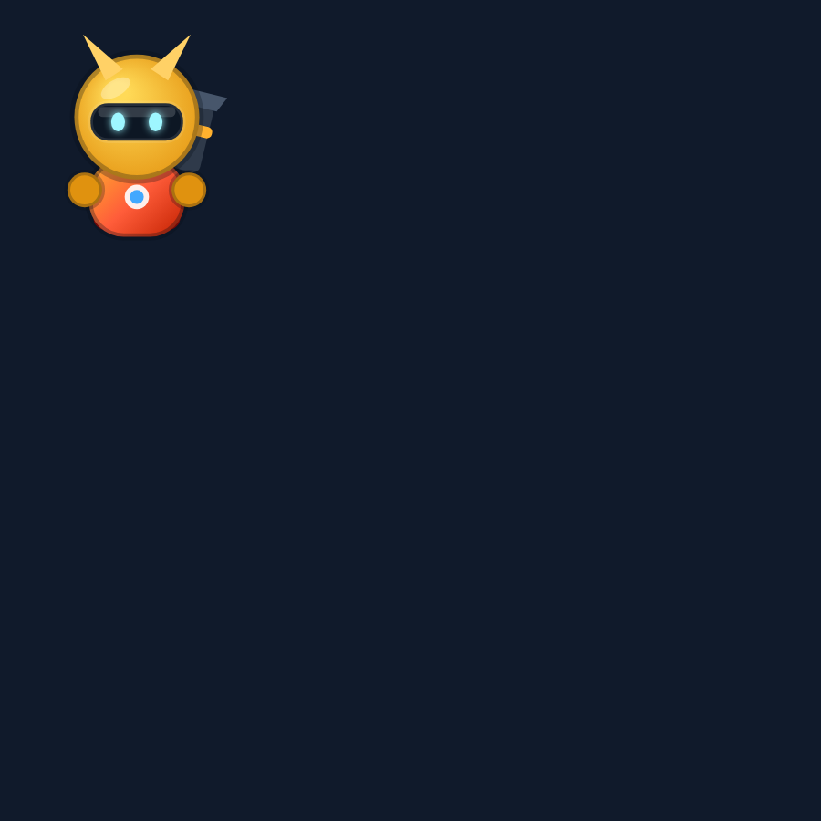

# ⚡ Brawl Arena

Динамичный аркадный шутер **3 на 3** прямо в браузере — вдохновлён Brawl Stars, но со своими
бравлерами, картами, режимами и «фишками». Никаких установок: открыл страницу и играешь.
Работает на ПК (мышь + клавиатура) и на телефоне (два виртуальных стика).


<p align="center">
  
  
</p>

## Что внутри

**9 бравлеров**, у каждого свой характер, оружие, суперспособность и гаджет:

| Бравлер | Роль | Атака | Супер | Гаджет |
|---|---|---|---|---|
| 🔥 Блейз | Боец | Дробовик (4 дробины) | Огненный шквал с отбрасыванием | Рывок |
| 🔵 Вектор | Стрелок | Очередь из 3 импульсов | Пробивающий рельсотрон | Мгновенная перезарядка |
| 🟣 Мира | Снайпер | Тяжёлый точный выстрел | Прыжок с замедляющими бомбами | Раскрыть врагов |
| 🟡 Гром | Танк | Дробовик в упор | Таран с отбрасыванием | Каменная кожа (щит) |
| 🟢 Люма | Поддержка | Снаряд лечит союзников и бьёт врагов | Лечение + щит всей команде | Массовое лечение |
| 🟠 Бум | Метатель | Бомбы **через стены** | Минное поле | Ускорение |
| 🌸 Коготь | Убийца | Клинки в упор | Прыжок к цели | Невидимость |
| 🩵 Пинг | Рикошет | Пули **отскакивают от стен** | Шквал из 6 рикошетов | Энергощит |
| ❄️ Крио | Контроль | Ледяные иглы с замедлением | Ледяная зона | Снятие замедлений + ускорение |

**3 режима:**

- 💎 **Захват кристаллов** — собирайте кристаллы в центре, удержите 10 штук 15 секунд.
- ⚽ **Бравл-бол** — футбол без правил, забейте 2 гола (мяч можно отобрать касанием, а удар
  заполняет шкалу супера).
- ⭐ **Награда** — убивайте врагов и собирайте звёзды, серия убийств повышает цену вашей головы.

**4 симметричные арены** с 4 темами оформления: Кристальная шахта, Ледяной разлом, Стадион, Каньон.

## Особенности

- **Умные боты** трёх уровней сложности: A*-поиск пути по сетке, отдельные боевые роли
  (агрессор/стрелок/поддержка/защитник ворот), уклонение от снарядов, предсказание движения,
  осмысленное использование суперов и гаджетов.
- **Полноценная боевая система**: перезарядка патронов по одному, урон с множителями, щиты,
  замедление/заморозка, отбрасывание, невидимость, разрушаемые ящики, скрытность в кустах,
  респавн с неуязвимостью.
- **Визуал на Canvas 2D**: процедурно нарисованные бравлеры и оружие, следы снарядов, взрывы,
  частицы, тряска камеры, параллакс-фон, динамические кусты. Всё рисуется кодом — ни одной картинки.
- **Процедурный звук и музыка** на WebAudio (без аудиофайлов), ограничитель частоты звуков.
- **Интерфейс**: главное меню с анимированным героем, выбор бравлера с портретами, живой HUD
  (HP/щит/патроны/супер/гаджет/таймер/лента убийств/табло), экран результатов, настройки
  (громкость, помощь прицеливания, тряска, FPS), сохранение прогресса в `localStorage`.
- **Управление**: WASD + мышь на ПК, два стика и автоприцел на телефоне, кнопки супера и гаджета.

## Как играть — три способа

### 1. Установить как приложение (PWA)

Откройте игру по http-адресу и нажмите кнопку **«Установить»** в шапке (или иконку 💾 →
«Установить как приложение»):

- **Android / Chrome / Edge:** меню браузера → «Установить приложение».
- **iPhone / iPad / Safari:** кнопка «Поделиться» → «На экран „Домой“».
- **ПК (Chrome/Edge):** иконка установки в адресной строке.

Игра появится отдельным окном на рабочем столе и будет работать **без интернета** —
service worker кэширует все модули, звук и графику.

### 2. Скачать один файл

В игре: кнопка 💾 → **«Скачать .html»** (или откройте `release/BrawlArena.html` напрямую).
Это самодостаточный файл ~190 КБ: сохраните и открывайте двойным щелчком, сервер и интернет
не нужны.

### 3. Запустить локально из исходников

```bash
npm start          # http://localhost:8080
```

Или любой статический сервер (`python3 -m http.server 8080`, `npx serve .`).
Исходники — нативные ES-модули, сборка не требуется. Открывать `index.html` из `file://`
нельзя (браузер заблокирует модули) — для этого есть офлайн-сборка из пункта 2.

### Пересборка релизов

```bash
npm run build      # обновляет sw.js (новая версия кэша) и release/BrawlArena.html
npm run icons      # перегенерировать иконки приложения
```

## Управление

| Действие | ПК | Телефон |
|---|---|---|
| Движение | `WASD` / стрелки | левый стик |
| Прицел | мышь | правый стик |
| Выстрел | ЛКМ (удерживайте — очередь) | отпустить правый стик / тап |
| Супер | `ПКМ` или `Space` | кнопка справа внизу |
| Гаджет | `Q` | кнопка слева от супера |
| Табло матча | `Tab` | — |
| Пауза | `Esc` / `P` | кнопка ❚❚ |

## Скриншоты и портреты

<p align="center"></p>

## Структура

```
index.html          — разметка экранов и HUD
styles.css          — вся стилизация интерфейса
src/
  main.js           — точка входа, игровой цикл, сохранения
  game.js           — ядро матча: физика, стрельба, способности, режимы
  ai.js             — поведение ботов
  pathfinding.js    — A* по сетке арены
  render.js         — рендерер Canvas 2D
  ui.js             — экраны, HUD, результаты
  input.js          — клавиатура, мышь, виртуальные стики
  audio.js          — процедурные звуки и музыка (WebAudio)
  ...
  maps.js           — карты и темы
  config.js         — бравлеры, режимы, баланс
  utils.js          — математика и вспомогательные функции
scripts/            — проверки: карты, headless-симуляция матчей, тест UI, рендер в PNG,
                      генерация иконок и сборка офлайн-версии
icons/              — иконки приложения (PWA)
release/            — BrawlArena.html: вся игра в одном файле + инструкция
manifest.webmanifest, sw.js — установка и офлайн-режим
```

## Проверки

```bash
npm run test:offline              # офлайн-сборка: запуск одного HTML-файла, манифест, иконки, SW
npm run check                     # карты: симметрия, спавны, доступность центра
npm run test:abilities            # все суперы и гаджеты: урон, лечение, эффекты, кулдауны
npm run sim                       # headless-прогон 9 матчей (все бравлеры × все режимы)
npm i --no-save jsdom @napi-rs/canvas
npm run test:input                # мышь, клавиатура, виртуальные стики, автоприцел
npm run test:ui                   # интерфейс: экраны, HUD, настройки (jsdom)
npm run test:bootstrap            # полная инициализация игры и матч от кнопки «В бой»
npm run shot                      # рендер арены в PNG (нужен @napi-rs/canvas)
```

Тесты не входят в рантайм игры: для самой игры зависимостей нет вообще.

## Баланс

Основные параметры собраны в `src/config.js` (здоровье, скорость, урон, перезарядка, урон и
радиус способностей) и в `src/game.js` (формулы урона, начисления супера, тайминги режимов).
Сложность ботов настраивается в `DIFFICULTY`: время реакции, ошибка прицела, шанс уклонения,
множители урона и здоровья.
